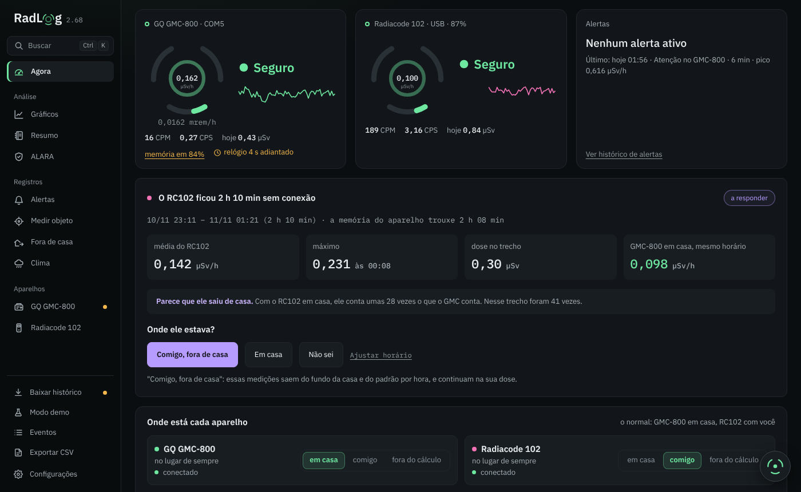
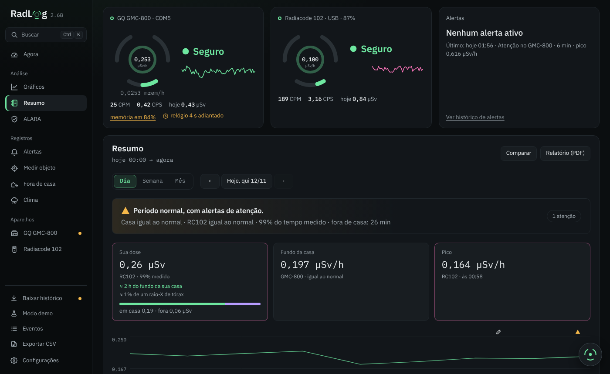
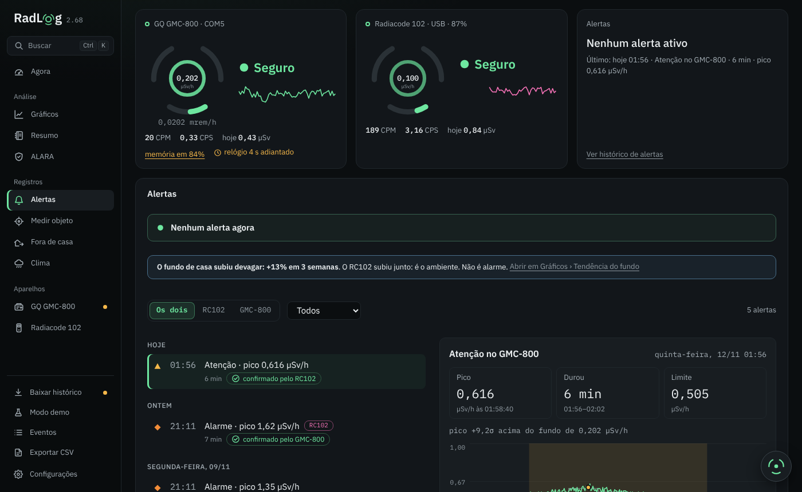
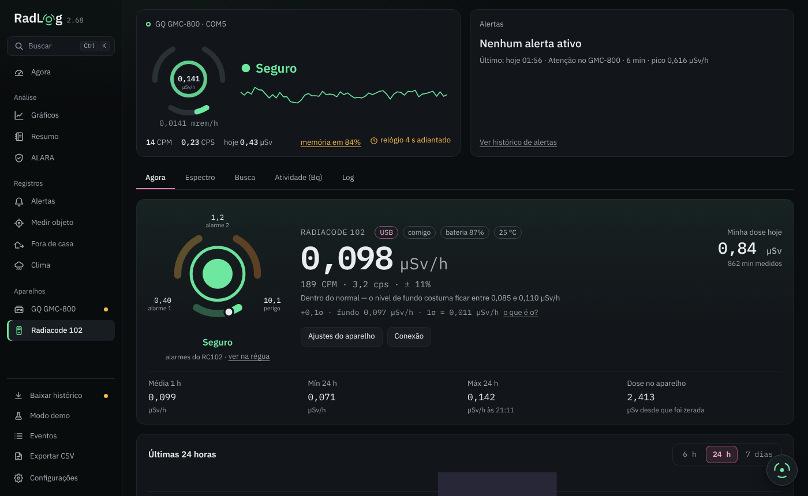
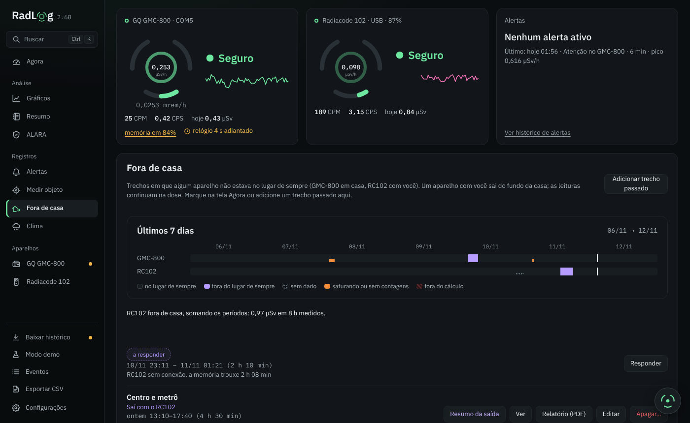
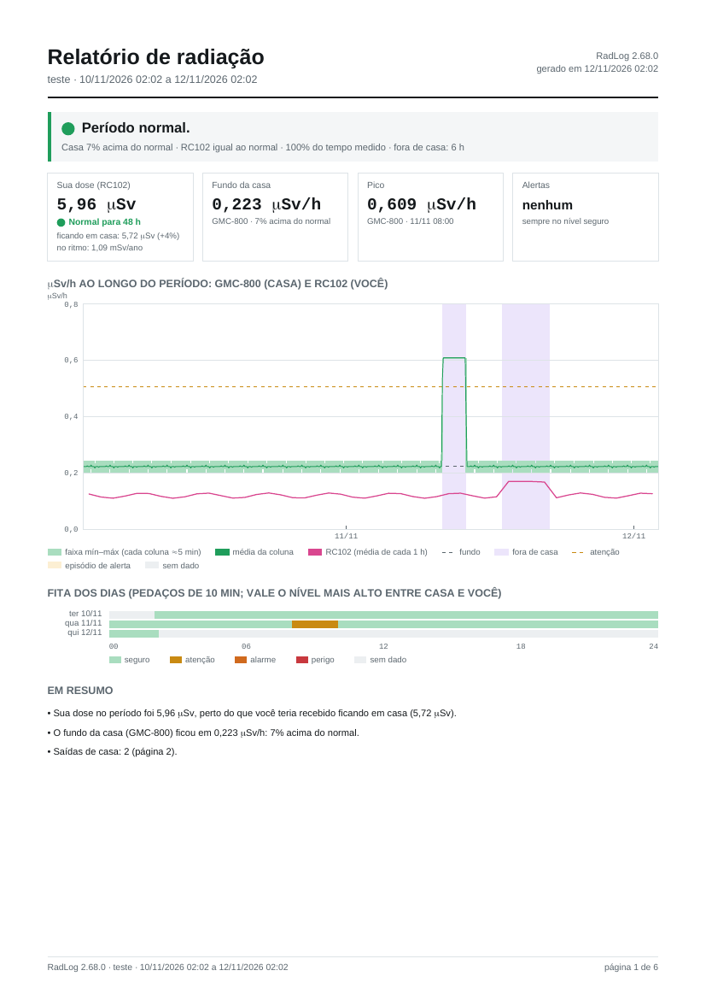

<p align="center">
  <picture>
    <source media="(prefers-color-scheme: dark)" srcset="docs/logo-dark.svg">
    
  </picture>
</p>

Registro de radiação ionizante para dois aparelhos: o contador Geiger
**GQ GMC-800** (monitor de área, parado em casa) e o **Radiacode 102**
(dosímetro pessoal com espectrômetro, anda com você). Feito em Go + Wails,
para Windows e Linux, em português (com tradução para inglês).

O app lê os aparelhos pela USB (o Radiacode 102 também pelo Bluetooth),
guarda uma leitura por minuto e mostra tudo em µSv/h: leitura ao vivo,
gráficos, dose, alertas, espectro, clima × radiação, medição de objetos e
relatórios em PDF. Os dados ficam só no seu computador.

Versão atual: veja as [Releases](../../releases) e o [CHANGELOG](CHANGELOG.md).
O app de Android (3.0, para levar o Radiacode 102 no bolso) está a caminho.



> Até a 1.x se chamava **GMC Monitor**. A 2.0 leva os dados sozinha para a
> pasta nova na primeira vez que abre.

## Baixar e atualizar

Os arquivos prontos ficam em **[Releases](../../releases)**:

- **Windows**: `RadLog-vX.Y.Z.exe`. Não precisa instalar; o WebView2 já vem
  no Windows 10/11.
- **Linux**: `RadLog-vX.Y.Z-x86_64.AppImage`, ou o
  `radlog-vX.Y.Z-linux-x86_64.tar.gz` com o binário e o `install.sh`. Precisa
  da WebKitGTK 4.1 (`sudo apt install libwebkit2gtk-4.1-0`).

O app procura versão nova ao abrir e uma vez por dia. Antes de instalar, ele
confere o SHA-256 do arquivo baixado e a **assinatura Ed25519** da lista de
somas (`SHA256SUMS.txt.sig`): sem assinatura válida, a versão é recusada.
Também dá para trocar à mão: abra a versão nova com a antiga aberta, e a
antiga fecha e passa o lugar.

## As telas

- **Agora**: os dois aparelhos lado a lado, cada um com mostrador, nível
  (seguro, atenção, alarme, perigo, sempre com cor **e** símbolo), frase
  dizendo se está dentro do normal, gráfico da última hora e a fita do dia.
  Embaixo do µSv/h vem o mesmo valor em mrem/h, pequeno. O anel do
  mostrador pode piscar a cada contagem (pulso da contagem).
- **Gráficos**: ao longo do tempo (com zoom arrastando), por hora do dia,
  padrões, **tendência** (fundo por dia em µSv/h pela calibração atual e
  subida lenta do fundo) e o **calendário do ano** (fundo de casa ou sua
  dose, dia a dia).
- **Resumo**: Dia, Semana ou Mês com setas para andar no tempo, uma frase
  com o que importa, a dose comparada com um raio-X de tórax, quanto tempo
  ficou em casa e fora, o gráfico com a fita dos dias e as saídas de casa
  do período. Também compara dois dias e gera o **relatório em PDF**.
- **ALARA**: de onde vem a sua dose e testes de tempo, distância e
  blindagem; a explicação fica recolhida em "Por que isso importa".
- **Alertas**: uma lista só, dos dois aparelhos, com o detalhe ao lado
  (gráfico, duração, pico). Cada alerta diz se o outro aparelho
  **confirmou** a subida (confirmação cruzada), e o painel **"Por que
  subiu?"** confere as causas comuns (acaso, o outro aparelho, chuva,
  radônio, pressão, objeto, saída de casa) com os seus dados.
- **Medir objeto**: fundo e objeto pelo mesmo tempo, diferença com margem
  de erro, veredito e a dose comparada com coisas conhecidas.
- **Fora de casa**: períodos em que você saiu levando o Radiacode 102;
  entram na dose, mas não no fundo da casa. Cada saída mostra só o
  aparelho que foi junto, e o app pergunta "Voltou para casa?" quando o
  RC102 volta a ler o fundo de casa. O **Resumo da saída** traz horário,
  dose, pico, gráfico, o espectro da saída comparado com o de casa e o que
  o aparelho registrou (bateria, temperatura, avisos).
- **Clima**: chuva (radar RainViewer e modelo Open-Meteo) e pressão
  × radônio. Opcional; a cidade fica só nos ajustes deste PC.
- **GQ GMC-800**: abas **Agora** (leitura, histórico da memória do
  contador, relógio, ajustes do aparelho e calibração, inclusive gravar no
  próprio contador o fator da intercalibração com o Radiacode 102) e
  **Saúde do tubo** (se o Geiger está contando como deveria).
- **Radiacode 102**: leitura, **Tela do aparelho** (o espectro que o RC102
  mostra e que o botão Recomeçar zera) e **Acumulado do aparelho** (o
  espectro de longo prazo, só leitura), os dois com isótopos e zoom no
  pico; **Espectrograma** (espectro ao longo do tempo), busca, atividade
  (Bq), log, ajustes e alarmes do aparelho, e o histórico que ele gravou
  longe do PC. Cada cartão explica o que mostra em "Como funciona".
- **Configurações**: alarmes e níveis do app, janela e tela (tamanho,
  densidade, número no ícone da bandeja, pulso), dados, backup e
  sincronização entre PCs.

| Resumo | Alertas |
|---|---|
|  |  |
| **Radiacode 102** | **Fora de casa** |
|  |  |

Os prints são do modo demonstração, com dados de mentira.

Busca rápida com **Ctrl+K**. O logo é um botão para anotar, marcar saída de
casa e medir um objeto.

## Dose

A sua dose vem do Radiacode 102. O valor principal é o **contador do
próprio aparelho**; ao lado aparece a soma que o app fez com as leituras de
minuto a minuto ("app 0,84"), como conferência. O GMC-800 fica parado em
casa e mede o ambiente, não a sua dose.

## Relatório em PDF

O botão **Relatório (PDF)** abre um diálogo para escolher entre
**Completo** e **Só o resumo**, e se entram as anotações e as configurações
(o app lembra da escolha):

1. **Resumo**: uma frase, quatro números, o gráfico dos dois aparelhos com
   as saídas de casa marcadas e a fita dos dias. A dose vem comparada com a
   que você teria ficando em casa: normal, acima do normal ou alta.
2. **Por dia**: fundo de casa, sua dose, pico e alertas de cada dia; a
   lista de alertas (confirmados ou não pelo outro aparelho), as saídas de
   casa, as medições, a chuva e as anotações.
3. **Espectro**: o espectro do Radiacode 102 no período e o de cada saída,
   comparados com o de casa, com os isótopos achados.
4. **Anexo técnico** (A1 a A8): estatística, dias, fundo, episódios,
   leituras acima do limite, falhas, configurações e limites.

O PDF nunca leva GPS nem nome de lugar.

<p align="center"></p>

## Alarmes

- Faixas do app em µSv/h (atenção, alarme e perigo), por aparelho. O nível
  **perigo** não pode ser desligado, só silenciado por um tempo.
- O Radiacode 102 também pode usar os alarmes do próprio aparelho.
- Aviso de Geiger saturado, de leitura fora da escala e de **subida lenta
  do fundo** (quando o fundo de casa sobe aos poucos ao longo de semanas).
- Alertas retroativos: o que passou do limite com o app fechado vira alerta
  com a hora certa quando o histórico é baixado.
- Ícone na bandeja com a leitura na cor do nível; alarme e perigo trazem a
  janela para a frente.

## Onde ficam os dados

Windows: `%AppData%\RadLog\`. Linux: `~/.config/RadLog/`. O botão "pasta de
dados" abre a pasta. O que tem lá:

- `leituras/AAAA-MM.csv`: uma linha por minuto de cada aparelho, abre no
  Excel;
- `historico/` e `configuracao/`: cópias brutas da memória e da
  configuração do contador;
- `eventos.csv`, `medicoes.json`, `fora-de-casa.json`, `anotacoes.json`:
  alertas, medições, saídas de casa e anotações;
- `chuva*.json`: chuva e pressão (se o Clima estiver ligado);
- `config.json`: configurações; `log.txt` e `diagnostico.txt`: log técnico.

O **backup** (.zip) junta só o que falta ao importar e serve para levar os
dados de um PC para outro, Windows ou Linux. Localização e cidade nunca vão
para PDF, relatório ou backup.

## Compilar

Precisa do [Go](https://go.dev/dl/) 1.22 ou mais novo. Não precisa do Wails
CLI nem de Node: a interface é HTML, CSS e JS puros em `frontend/dist/`.

Windows (precisa do WebView2, que já vem no Windows 10/11):

```
scripts\build.bat
```

Linux:

```
sudo apt install golang libgtk-3-dev libwebkit2gtk-4.1-dev   # Debian/Ubuntu
./scripts/build-linux.sh
```

Para ler os aparelhos sem root no Linux, o usuário precisa estar no grupo
`dialout` (`sudo usermod -aG dialout $USER` e entrar de novo).

A interface também abre direto no navegador (`frontend/dist/index.html`) em
**modo demonstração**, com dados falsos dos dois aparelhos.

### Releases

O GitHub Actions (`.github/workflows/release.yml`) compila o `.exe`, o
AppImage e o `.tar.gz` quando a versão de `internal/app/version.go` muda no
`main`, assina o `SHA256SUMS.txt` e publica com o trecho da versão no
CHANGELOG. Quando o segredo `NOTION_TOKEN` existe, um passo a mais registra
a versão no quadro do projeto no Notion.

## Testes

```
go test ./internal/...
```

Os testes do GMC-800 usam respostas gravadas de um aparelho real.

## Estrutura

```
main.go                 embute a interface e chama o app
internal/app/           o app (os métodos exportados de App são o que a interface chama)
internal/gmc/           protocolo do GQ GMC-800 (serial, calibração, histórico)
internal/radiacode/     protocolo do Radiacode 102 (USB e Bluetooth)
internal/core/          contas puras: alertas, dose, intercalibração, níveis, estatística
internal/store/         leituras em CSV mensal
internal/pdf/           gerador de PDF mínimo, sem dependências
internal/i18n/          tradução (en.tsv)
internal/updsig/        chave pública que confere as atualizações
frontend/dist/          interface (um arquivo .js por tela)
build/                  ícone, manifesto do .exe e arquivos do Linux
scripts/                build e ferramentas de tradução
```

## Observações sobre o GMC-800

O GMC-800 diz seguir o GQ-RFC1201, mas na prática difere: CPM e CPS vêm em
4 bytes, a configuração tem 512 bytes com layout próprio e o `SPIR` às vezes
manda um byte a mais. A configuração é gravada com `ECFG`,
`WCFG[endereço alto][endereço baixo][valor]` e `CFGUPDATE`. Os detalhes
foram conferidos com o projeto [PyGMC](https://pypi.org/project/pygmc).

## Licença

Código sob a licença MIT (veja [LICENSE](LICENSE)). Fontes IBM Plex sob a SIL
Open Font License (`frontend/dist/fonts/OFL-IBM-Plex.txt`).

Não é um produto da GQ Electronics nem da Radiacode. "GMC" e "GQ" são marcas
da GQ Electronics; "Radiacode" é marca da Radiacode. O app só fala com os
aparelhos pelos protocolos deles.
