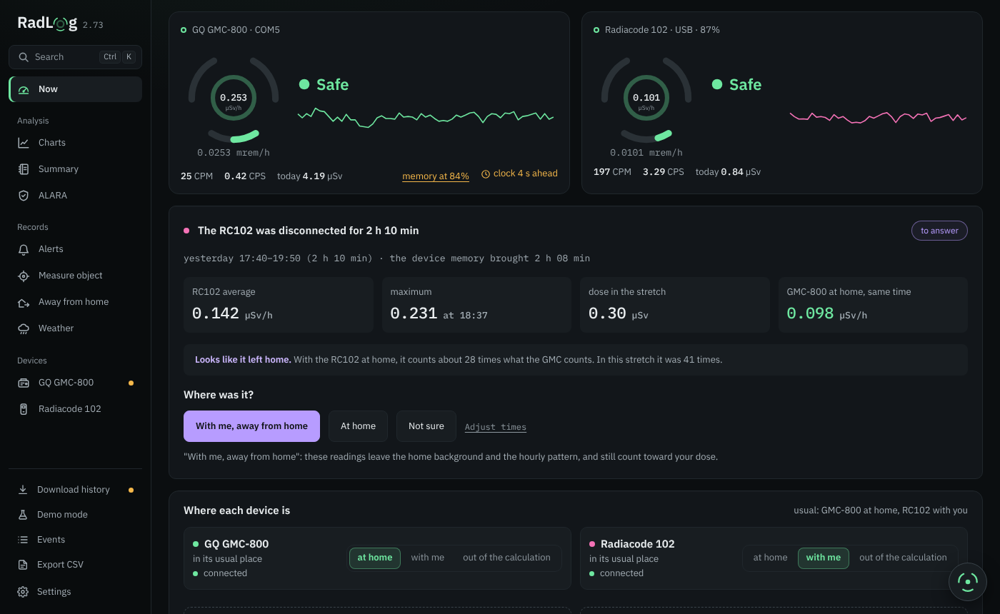
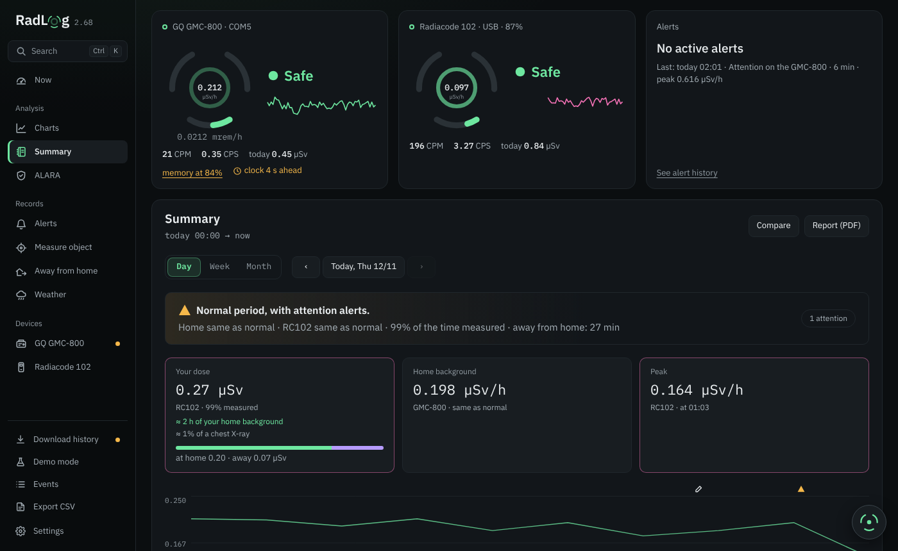
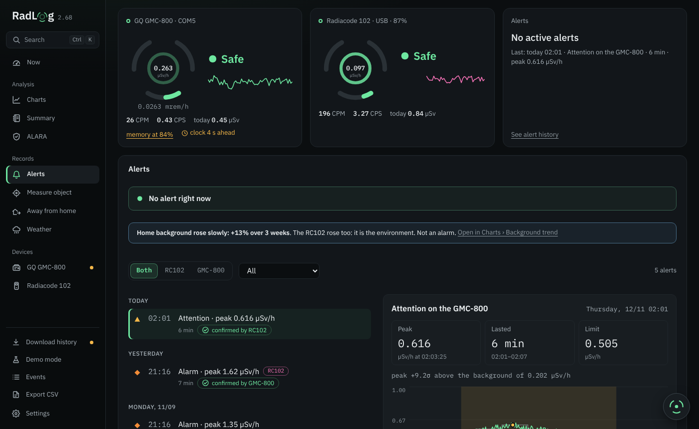
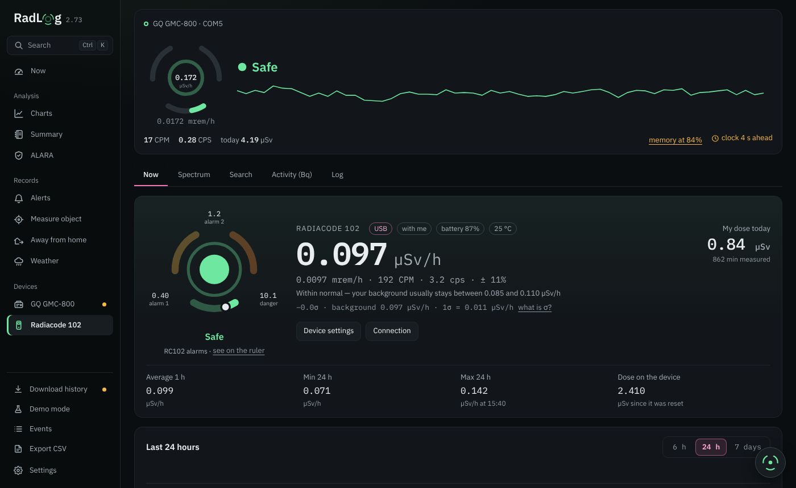
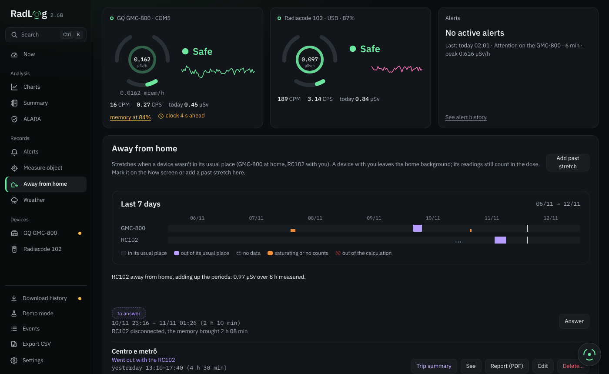
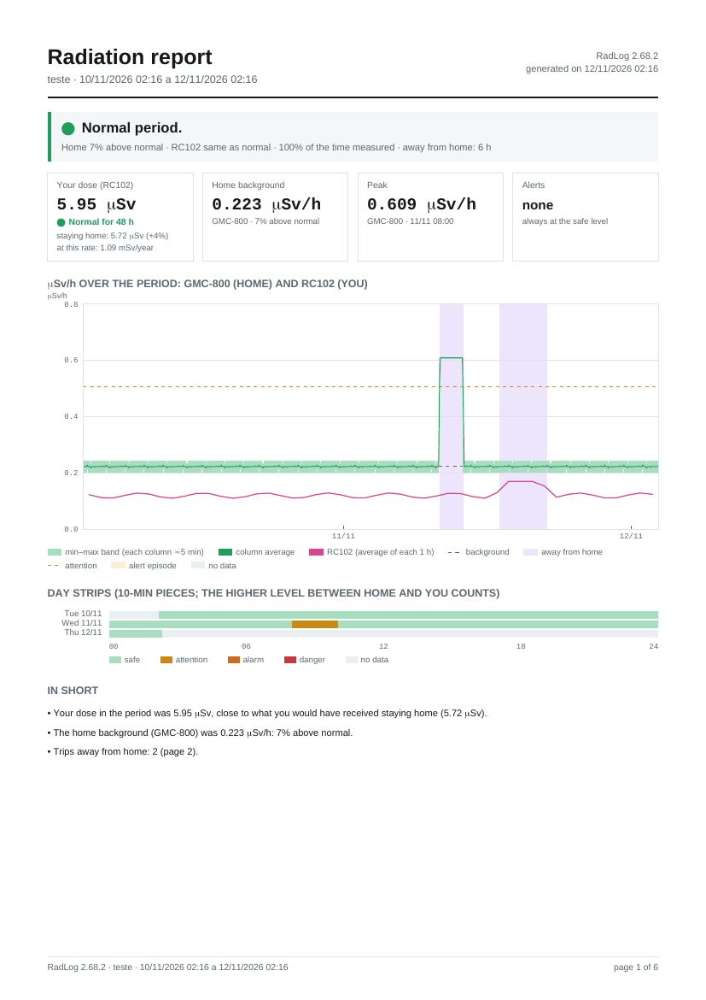

<p align="center">
  
  
</p>

<p align="center"><b>English</b> · <a href="README.pt-BR.md">Português (Brasil)</a></p>

RadLog is a desktop app that logs ionizing radiation from two devices: the
**GQ GMC-800** Geiger counter and the **Radiacode 102** dosimeter and gamma
spectrometer. It runs on Windows and Linux, works with one device or both,
and is available in English and Brazilian Portuguese.

It reads the devices over USB (the Radiacode 102 also over Bluetooth), keeps
one reading per minute and shows everything in µSv/h: live readings, charts,
dose, alerts, spectra, weather × radiation, object measurements and PDF
reports. All data stays on your computer.

Current version: see [Releases](../../releases) and the
[changelog](CHANGELOG.md) (in Portuguese). An Android app (3.0) is in the
works.



## Download and update

Ready-to-run files are on the **[Releases](../../releases)** page:

- **Windows**: `RadLog-vX.Y.Z.exe`. No installation needed; WebView2 already
  ships with Windows 10/11.
- **Linux**: `RadLog-vX.Y.Z-x86_64.AppImage`, or
  `radlog-vX.Y.Z-linux-x86_64.tar.gz` with the binary and `install.sh`.
  Requires WebKitGTK 4.1 (`sudo apt install libwebkit2gtk-4.1-0`).

The app checks for a new version when it opens and once a day. Before
installing, it verifies the SHA-256 of the download and the **Ed25519
signature** of the checksum list (`SHA256SUMS.txt.sig`); a version without a
valid signature is refused. You can also update by hand: open the new version
while the old one is running, and the old one closes and hands over.

## How it works

Each device has a role. By default the GMC-800 is the **home monitor**: it
stays in one place and measures the background where you live. The Radiacode
102 is your **personal dosimeter**: it goes with you, and its readings make
up your dose. Any stretch of time can be marked differently: you took the
Geiger with you, you left the Radiacode at home, or a device was out of the
calculation. Those stretches still count toward your dose but stay out of
the home background.

## Screens

- **Now**: both devices side by side, each with a dial, a level (safe,
  attention, alarm, danger, always shown by color **and** shape), a sentence
  saying whether the reading is normal, the last hour and the day strip.
  The µSv/h value also shows in mrem/h. The dial ring can blink with every
  count.
- **Charts**: over time (drag to zoom), by hour of day, patterns, **trend**
  (daily background in µSv/h and slow background rise) and the **year
  calendar** (home background or your dose, day by day).
- **Summary**: Day, Week or Month with arrows to move through time, one
  sentence with what matters, your dose compared with a chest X-ray, time at
  home and away, a chart with the day strip and the trips in the period.
  It can also compare two days and create the **PDF report**.
- **ALARA**: where your dose comes from, and time, distance and shielding
  tests.
- **Alerts**: one list for both devices, with the details alongside (chart,
  duration, peak). Each alert says whether the other device **confirmed**
  the rise (cross-check), and the **"Why did it rise?"** panel checks the
  usual causes (chance, the other device, rain, radon, pressure, an object,
  a trip) against your data.
- **Measure object**: background and object over the same time, the
  difference with its margin of error, a verdict and the dose compared with
  familiar things.
- **Away from home**: the stretches when a device left its usual place.
  Each trip shows the device you took, and the app asks "Are you back home?" when
  the readings match home again. The **trip summary** has the times, dose,
  peak, chart, the trip spectrum against the home spectrum and what the
  device logged (battery, temperature, warnings).
- **Weather**: rain (RainViewer radar and the Open-Meteo model) and
  pressure × radon. Optional; the city is stored only in this PC's settings.
- **GQ GMC-800**: **Now** (reading, the counter's memory history, clock,
  device settings and calibration, including writing the
  cross-calibration factor with the Radiacode 102 into the counter itself)
  and **Tube health** (whether the Geiger tube is counting as it should).
- **Radiacode 102**: reading, **Device screen** (the spectrum the device
  shows, which Start over clears) and **Device's accumulated** (the
  long-term spectrum, read only), both with isotopes and peak zoom;
  **Spectrogram** (spectrum over time), search, activity (Bq), log, device
  settings and alarms, and the history it recorded away from the PC. Each
  card explains itself under "How it works".
- **Settings**: app alarms and levels, window and display (size, density,
  number on the tray icon, count blink), data, backup and sync between PCs.

| Summary | Alerts |
|---|---|
|  |  |
| **Radiacode 102** | **Away from home** |
|  |  |

Screenshots are from demo mode, with made-up data.

Quick search with **Ctrl+K**. The logo button lets you add a note, mark that
you left home and measure an object.

## Dose

Your dose comes from the device you carry, normally the Radiacode 102. The
main value is the **device's own dose counter**; next to it the app shows its
own sum of the minute-by-minute readings, as a cross-check. The home monitor
measures the place, not you.

## PDF report

The **Report (PDF)** button opens a dialog to choose **Full** or **Summary
only**, and whether to include notes and settings (the app remembers your
choice):

1. **Summary**: one sentence, four numbers, a chart of both devices with the
   trips marked, and the day strip. Your dose is compared with what you would
   have received staying home: normal, above normal or high.
2. **By day**: home background, your dose, peak and alerts for each day;
   the alert list (confirmed or not by the other device), trips,
   measurements, rain and notes.
3. **Spectrum**: the Radiacode 102 spectrum for the period and for each
   trip, against the home spectrum, with the isotopes found.
4. **Technical appendix** (A1 to A8): statistics, days, background,
   episodes, time above the limits, gaps, settings and limitations.

The PDF never includes GPS or place names.

<p align="center"></p>

## Alarms

- App levels in µSv/h (attention, alarm and danger), per device. **Danger**
  can't be turned off, only silenced for a while.
- The Radiacode 102 can also use the device's own alarms.
- Warnings for a saturated Geiger tube, an off-scale reading and a **slow
  background rise** (when the home background creeps up over weeks).
- Retroactive alerts: anything that crossed a limit while the app was closed
  becomes an alert with the right time once the history is downloaded.
- Tray icon with the reading in the level color; alarm and danger bring the
  window to the front.

## Where the data lives

Windows: `%AppData%\RadLog\`. Linux: `~/.config/RadLog/`. The "data folder"
button opens it. File names are in Portuguese:

- `leituras/YYYY-MM.csv`: one line per minute per device (opens in Excel);
- `historico/` and `configuracao/`: raw copies of the counter's memory and
  configuration;
- `eventos.csv`, `medicoes.json`, `fora-de-casa.json`, `anotacoes.json`:
  alerts, measurements, trips and notes;
- `radiacode/`: the Radiacode 102 minutes, dose, spectra per minute and
  activity measurements;
- `alertas-detalhe/`: the second-by-second readings around each alert;
- `medicoes-anexos/`: photos and files attached to measurements;
- `chuva*.json`: rain and pressure (when Weather is on);
- `config.json`: settings; `log.txt` and `diagnostico.txt`: technical log;
- `sincronizacao.json`: the keys of the paired PCs. Don't share this file:
  it is what lets another PC sync with yours. It never goes into a backup.

A **backup** (.zip) only adds what is missing when imported, so it also moves
data from one PC to another, Windows or Linux. Location and city never go
into a PDF, report or backup.

## Building

Requires [Go](https://go.dev/dl/) 1.26 or newer (the CI uses 1.27). No Wails CLI or Node needed:
the interface is plain HTML, CSS and JS in `frontend/dist/`.

Windows (needs WebView2, which ships with Windows 10/11):

```
scripts\build.bat
```

Linux:

```
sudo apt install golang libgtk-3-dev libwebkit2gtk-4.1-dev   # Debian/Ubuntu
./scripts/build-linux.sh
```

To read the devices without root on Linux, your user must be in the
`dialout` group (`sudo usermod -aG dialout $USER`, then log in again).

The interface also opens straight in a browser (`frontend/dist/index.html`)
in **demo mode**, with fake data from both devices.

### Releases

GitHub Actions (`.github/workflows/release.yml`) builds the `.exe`, the
AppImage and the `.tar.gz` when the version in `internal/app/version.go`
changes on `main`, signs `SHA256SUMS.txt` and publishes the release with
that version's changelog entry. When the `NOTION_TOKEN` secret exists, one
more step records the version on the project board in Notion.

## Tests

```
go test ./internal/...
```

The GMC-800 tests use responses recorded from a real device.

## Layout

```
main.go                 embeds the interface and starts the app
internal/app/           the app (App's exported methods are what the interface calls)
internal/gmc/           GQ GMC-800 protocol (serial, calibration, history)
internal/radiacode/     Radiacode 102 protocol (USB and Bluetooth)
internal/core/          pure math: alerts, dose, cross-calibration, levels, statistics
internal/store/         readings in monthly CSV files
internal/pdf/           minimal PDF writer, no dependencies
internal/i18n/          translation (en.tsv)
internal/updsig/        public key that verifies updates
frontend/dist/          interface (one .js file per screen)
build/                  icon, .exe manifest and Linux files
scripts/                build and translation tools
```

## Notes on the GMC-800

The GMC-800 claims to follow GQ-RFC1201, but in practice it differs: CPM and
CPS come in 4 bytes, the configuration is 512 bytes with its own layout, and
`SPIR` sometimes sends one extra byte. The configuration is written with
`ECFG`, `WCFG[high address][low address][value]` and `CFGUPDATE`. The details
were checked against the [PyGMC](https://pypi.org/project/pygmc) project.

## License

Code under the MIT license (see [LICENSE](LICENSE)). IBM Plex fonts under the
SIL Open Font License (`frontend/dist/fonts/OFL-IBM-Plex.txt`). The notices of
the third-party libraries inside the app are in
[frontend/dist/licencas.txt](frontend/dist/licencas.txt) and under Settings ›
Updates and about. To report a security problem, see [SECURITY.md](SECURITY.md).

Not a product of GQ Electronics or Radiacode. "GMC" and "GQ" are trademarks of
GQ Electronics; "Radiacode" is a trademark of Radiacode. The app only talks to
the devices through their protocols.
